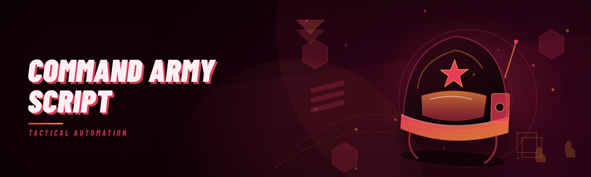

  
  
  

  

  
  
  

---

Command An Army Script — spawn troops, issue orders, control squads, and auto-battle in real time.

## Overview

Command An Army Script — spawn troops, issue orders, control squads, and auto-battle in real time.

  

## License

[MIT License](LICENSE)

  

